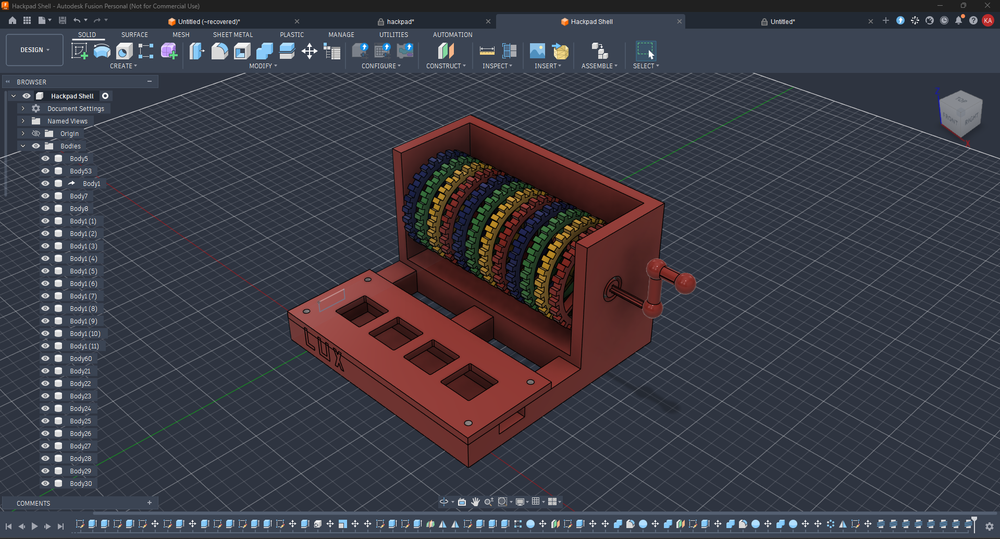

# LuxPad

This is my 4 key macro pad with a gear toy strapped next to it!!

this uses a module seediuno xiao microcontroller with 4 cherry mx switches for satisfying clicks! it also uses pog to change the keymap of each key and it uses KMK code. and whenever you get bored you can spin the gear toy which is attacked to it. i made it for macropadders who are also bored and just need and sort of fidgeting.

### Features
* Cherry MX Switches for maximum satisfaction!
* Hand made gears.
* KMK code for simplicity
* Pog to change keymaps

## CAD Model
The top and bottom part of the actual macro pad is held down by 2 standard screws while the gear toy is easy to assemble. print out the amount of gears you would like, place the rod through the bearing (do not use the 3d modelled bearings. use metal bearings) and while its half way there place as much gears as you like. when your done put it all the way until the end matches up with the end of the bearing

